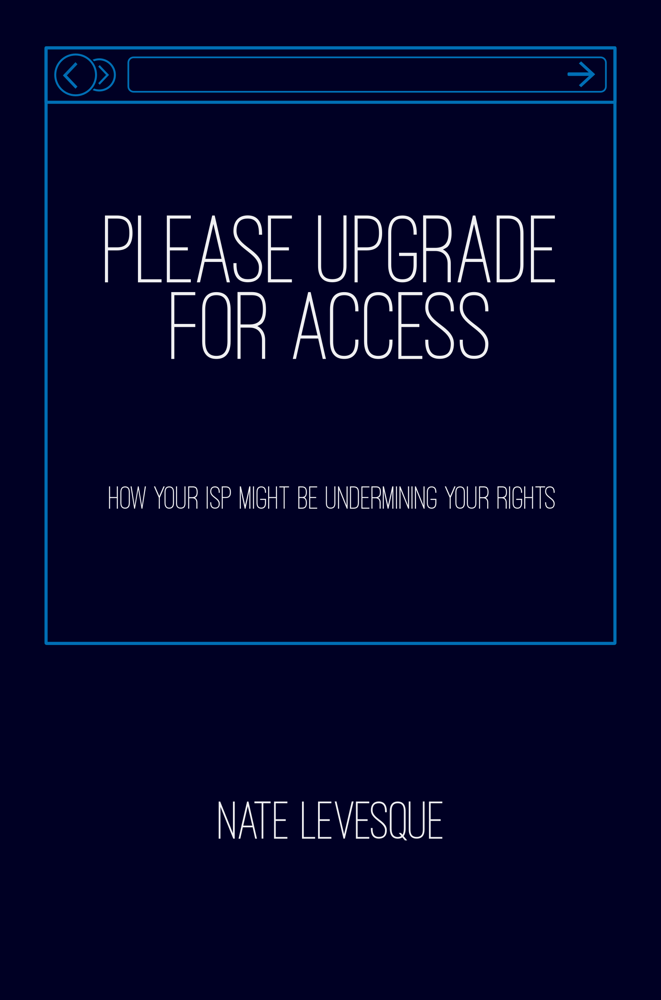

# {{ page.title }}

 
<a class="button special" target="_blank" href="https://books2read.com/please-upgrade-for-access" rel="noopener">
    Get Your Copy
</a>



## Book Description
It's easy to take the mostly neutral world of free speech online for granted. ISPs are hoping we continue to and that we won't notice as they take control of the web.

When a flow of information is centralized, it can be curated by those who own it to manipulate opinions, elections, and education. Western Union, a communications giant of the past, used that fact to manipulate the U.S. presidential election of 1876 with its absolute control over the telegraph network. There was no concept of net neutrality to stop it. We've seen similar things since with the centralization of radio, cable, and the telephone. How are ISPs trying to take over? What are the repercussions if they do? Can we keep the Internet open, or are we doomed to watch history repeat itself as big corporations take over?

"Please Upgrade for Access" outlines the ongoing fight for net neutrality by examining some of the ways many Internet providers—maybe even yours—are working to centralize access to the Internet and control what their customers can see. Our ability to choose, to innovate, and to be informed is at stake.
