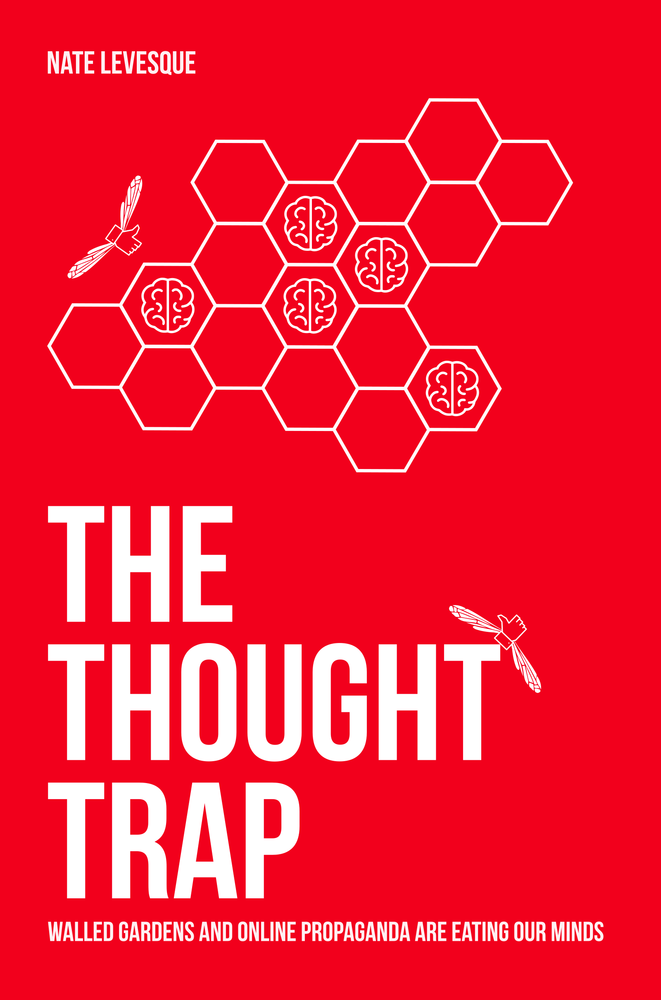

# {{ page.title }}

 
<a class="button special" target="_new" href="https://books2read.com/the-thought-trap" rel="noopener">Get Your Copy</a>



## Book Description
We live in an era like no other. Virtually unlimited information, social connections, and personalized recommendations are at our fingertips every second of every day. We can connect with anyone, anywhere, anytime. But is it the utopia it sounds like?

We’re overwhelmed with information. Our digital lives are tracked and analyzed. Our social feeds show us clickbait, hoaxes, and habit-forming features. New technologies have given us fake photos, Deepfake video, fabricated audio, and even realistic but completely computer-generated speeches from world leaders. Even the tools our social networks give us to report those problems are getting used against us.

We don’t always know who or what is behind it. But, they know our social media is a powerful place for propaganda. Mob mentality, confirmation bias, and our willingness to re-share without double checking make it easy for us to be manipulated—to trade the commodity that is our attention, to change our opinion, or to sell us something. And, we don’t always know why or when it’s happening.

_The Thought Trap_ examines the dystopian side to our web of unlimited information. How are we getting manipulated? To what end? What’s happening across the threshold of the massive online platforms we’re all part of?
